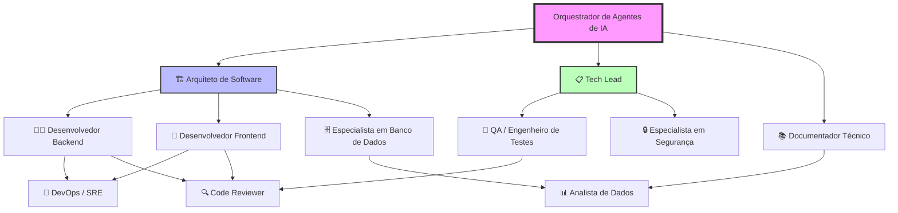
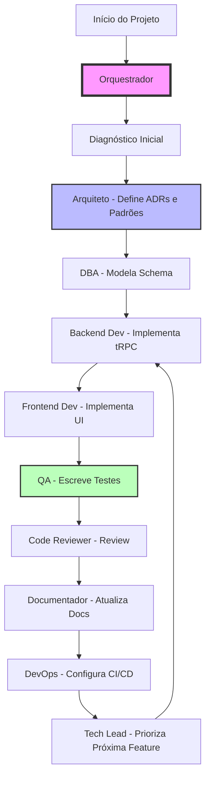

# Relatório do Orquestrador de Agentes de IA — Projeto Vitta

## 1. 🔍 Diagnóstico Inicial do Projeto

### Resumo Executivo

O projeto Vitta Pizzaria Napolitana é um MVP de cardápio digital mobile-first construído com React 19, Express, tRPC e Drizzle ORM. O stack é moderno e bem escolhido, com forte ênfase em type-safety. O MVP já implementa funcionalidades críticas (catálogo de produtos, carrinho, integração com WhatsApp). No entanto, há lacunas significativas em testes (apenas 2 arquivos de teste), documentação (README básico), CI/CD (não configurado) e estrutura de banco de dados (apenas tabela users, sem tabelas de domínio). O projeto está em estágio intermediário: infraestrutura sólida mas camada de negócio incompleta.

### Pontos Fortes

- **Stack moderno e type-safe**: React 19, TypeScript strict mode, tRPC para type-safety end-to-end, Drizzle ORM SQL-first
- **Estrutura monorepo clara**: Separação entre `client/`, `server/`, `shared/` com aliases configurados (`@/*`, `@shared/*`)
- **UI Components**: Radix UI + TailwindCSS com componentes reutilizáveis em `client/src/components/ui/`
- **Autenticação configurada**: OAuth flow implementado com JWT (jose), cookies, middleware de contexto
- **AWS S3 integrado**: Storage de imagens com presigned URLs em `server/storage.ts`
- **Mobile-first design**: Responsividade priorizada com hooks `useMobile.tsx`
- **MVP funcional**: Catálogo de pizzas/bebidas, carrinho, geração de mensagem WhatsApp (segundo TODO.md)
- **Vite configurado**: Build otimizado, plugins customizados para debug e config pública

### Riscos e Dívidas Técnicas

| Risco | Severidade | Impacto | Evidência |
|---|---|---|---|
| **Banco de dados sem tabelas de domínio** | Alta | Alta | `drizzle/schema.ts` tem apenas tabela `users`; TODO indica "Add your tables here" |
| **Cobertura de testes desconhecida** | Alta | Média | Apenas 2 arquivos `.test.ts` (`auth.logout.test.ts`, `platform.test.ts`); sem testes de componentes ou business logic |
| **CI/CD não configurado** | Média | Alta | Sem GitHub Actions, GitLab CI ou similar; deploy manual |
| **Documentação mínima** | Média | Média | README.md básico (14 linhas); sem docs de API, architecture, deployment |
| **Secrets potencialmente expostos** | Alta | Crítica | `.env` não documentado; sem `.env.example`; hardcoded em `server/_core/env.ts`? [SUPOSIÇÃO] |
| **tRPC routers vazios** | Média | Alta | `server/routers.ts` tem apenas `system` e `auth`; TODO indica "add feature routers here" |
| **Sem monitoramento/observabilidade** | Média | Média | Sem logging estruturado, error tracking (Sentry), health checks (exceto `/api/health` básico) |
| **Sem backup de banco de dados** | Alta | Crítica | Nenhuma estratégia de backup documentada; migrations em `drizzle/migrations/` sem rotina de backup |
| **TailwindCSS v4 alpha** | Baixa | Baixa | Usando `@tailwindcss/vite` (v4), que pode ter breaking changes |

### Lacunas de Informação

- **Histórico de commits**: Repositório não é git (erro: `not a git repository`)
- **Configuração de ambiente**: Variáveis `.env` não documentadas; valores desconhecidos
- **Estrutura de CI/CD**: Não existe; estratégia de deploy desconhecida
- **Estratégia de backup**: Não documentada
- **SLAs e requisitos de produção**: Não documentados
- **Integração WhatsApp**: Como funciona? API webhooks? [SUPOSIÇÃO]
- **Requisitos de escala**: Número esperado de usuários simultâneos?
- **Compliance**: LGPD? Regulamentações de dados?

### Suposições Explícitas

- [SUPOSIÇÃO] O projeto não está em controle de versão Git localmente (pode estar em outro repo ou remoto)
- [SUPOSIÇÃO] As funcionalidades de catálogo e carrinho mencionadas no TODO.md já estão implementadas em `client/src/pages/Home.tsx` (58 linhas) e `client/src/pages/ComponentShowcase.tsx` (58KB)
- [SUPOSIÇÃO] A integração com WhatsApp gera apenas mensagem de texto (sem webhooks ou automação de leitura)
- [SUPOSIÇÃO] O banco de dados MySQL está rodando localmente ou em RDS (não documentado)
- [SUPOSIÇÃO] O AWS S3 bucket já está criado e configurado
- [SUPOSIÇÃO] OAuth provider é Manus (referenciado em `server/_core/oauth.ts` e comentários)
- [SUPOSIÇÃO] A pizzaria ainda não tem impressão automática de pedidos (TODO indica "preparado para futura")

---

## 2. 🧩 Organograma da Equipe de Agentes



### Tabela Resumo

| Agente | Ícone | Missão | Quando é acionado |
|---|---|---|---|
| Orquestrador de Agentes de IA | 🤖 | Diagnóstico, planejamento e coordenação da equipe | Início do projeto, mudanças significativas |
| Arquiteto de Software | 🏗️ | Definir arquitetura, ADRs e padrões de código | Fase de design, refatorações arquiteturais |
| Tech Lead | 📋 | Priorização, DoD, coordenação de entregas | Sprint planning, code review, blockers |
| Desenvolvedor Backend | 👨‍💻 | Implementar tRPC routers, lógica de negócio server-side | Features backend, APIs, integrações |
| Desenvolvedor Frontend | 🎨 | Implementar componentes React, UI/UX | Features frontend, componentes, páginas |
| QA / Engenheiro de Testes | 🧪 | Testes, automação, cobertura | Antes de releases, refatorações críticas |
| Especialista em Banco de Dados | 🗄️ | Schema, índices, migrações, performance | Mudanças no schema, otimizações |
| DevOps / SRE | 🚀 | CI/CD, deploy, monitoring, AWS | Setup de infra, deploys, incidentes |
| Especialista em Segurança | 🔒 | OWASP, LGPD, secrets, auth | Setup inicial, security reviews |
| Documentador Técnico | 📚 | README, API docs, guias | Após cada feature, releases |
| Code Reviewer | 🔍 | Auditoria, dívida técnica | Em cada PR, refatorações |
| Analista de Dados | 📊 | Análise de custo-benefício, governança de dados | Features baseadas em dados |

### Justificativa dos Agentes

- **Arquiteto**: Necessário porque o stack (tRPC, Drizzle, React 19) requer padrões específicos e decisões arquiteturais documentadas (ADRs)
- **Backend + Frontend**: Separados porque o monorepo tem responsabilidades distintas (tRPC vs React components)
- **QA**: Crítico devido à baixa cobertura de testes atual (apenas 2 arquivos)
- **DBA**: O schema Drizzle está vazio (apenas `users`); necessário para modelar cardápio, pedidos, etc.
- **DevOps**: CI/CD e monitoring estão ausentes; essencial para produção
- **Security**: OAuth e JWT já implementados, mas secrets e LGPD não tratados
- **Documentador**: README básico; necessário para onboarding e manutenção
- **Code Reviewer**: Boa prática para manter qualidade no time
- **Tech Lead**: Coordenação entre agentes e priorização
- **Analista de Dados**: Futura análise de pedidos, comportamento de clientes (escalabilidade)

---

## 3. 📇 Fichas Individuais dos Agentes

### 🏗️ Arquiteto de Software

**Missão**: Definir arquitetura, ADRs e padrões de código para o projeto Vitta.

**Responsabilidades**:
- Documentar decisões arquiteturais (ADRs)
- Definir padrões para tRPC routers, React components, Drizzle schemas
- Estabelecer estrutura de pastas e nomenclatura
- Definir estratégia de escalabilidade (cache, lazy loading)
- Garantir consistência de código entre frontend e backend

**Prompt Individual**:
```
Você é o Arquiteto de Software do projeto Vitta Pizzaria Napolitana.

Stack: React 19, Express, tRPC v11, Drizzle ORM, MySQL, AWS S3, TailwindCSS.

Tarefas:
1. Ler a estrutura atual do projeto (client/, server/, shared/, drizzle/)
2. Criar ADRs para decisões arquiteturais existentes:
   - Por que tRPC sobre REST?
   - Por que Drizzle sobre Prisma?
   - Por que AWS S3 para storage?
3. Definir padrões de código:
   - Como estruturar um novo tRPC router?
   - Como estruturar um novo componente React?
   - Como modelar tabelas no Drizzle?
4. Documentar em docs/architecture.md
5. Criar diagramas Mermaid da arquitetura

Output: docs/architecture.md com ADRs, padrões e diagramas.
```

**Inputs**: Estrutura de pastas, código existente, package.json, tsconfig.json
**Outputs**: docs/architecture.md, docs/adr/, diagramas Mermaid
**Critérios de Sucesso**: ADRs documentados, padrões claros, diagramas legíveis
**Interage com**: Backend Dev, Frontend Dev, DBA, Tech Lead
**Ferramentas**: Mermaid, Markdown, read, write

---

### 👨‍💻 Desenvolvedor Backend

**Missão**: Implementar tRPC routers, lógica de negócio server-side e integrações.

**Responsabilidades**:
- Criar tRPC procedures com Zod schemas
- Implementar lógica de negócio (cardápio, pedidos, etc.)
- Integrar com AWS S3 (upload de imagens)
- Implementar autenticação/autorização
- Criar migrations Drizzle

**Prompt Individual**:
```
Você é o Desenvolvedor Backend do projeto Vitta.

Stack: Express, tRPC v11, Drizzle ORM, MySQL, JWT (jose), AWS S3.

Tarefas:
1. Ler server/routers.ts para entender a estrutura atual
2. Criar novos routers conforme necessário:
   - menuRouter: CRUD de pizzas, bebidas
   - orderRouter: gerenciamento de pedidos
3. Cada procedure deve ter:
   - Input Zod schema validado
   - Output Zod schema tipado
   - Error handling com TRPCError
   - Autenticação quando necessário
4. Criar migrations Drizzle para novas tabelas
5. Testar procedures com Vitest

Output: Código em server/routers/, migrations em drizzle/migrations/
```

**Inputs**: docs/architecture.md, drizzle/schema.ts, server/routers.ts
**Outputs**: tRPC routers, migrations, testes
**Critérios de Sucesso**: Procedures tipadas, testadas, com error handling
**Interage com**: Arquiteto, DBA, QA, DevOps
**Ferramentas**: TypeScript, Drizzle, tRPC, Vitest

---

### 🎨 Desenvolvedor Frontend

**Missão**: Implementar componentes React, UI/UX e integração com tRPC.

**Responsabilidades**:
- Criar componentes React reutilizáveis
- Integrar com tRPC client
- Implementar pages (Home, Menu, Cart, etc.)
- Usar Radix UI components
- Aplicar identidade visual (Vitta: preto/carvão, cobre/dourado, marfim)

**Prompt Individual**:
```
Você é o Desenvolvedor Frontend do projeto Vitta.

Stack: React 19, Vite, TailwindCSS, Radix UI, Wouter, TanStack Query, tRPC client.

Tarefas:
1. Ler client/src/ para entender estrutura atual
2. Criar componentes em client/src/components/:
   - MenuItem (card de pizza/bebida)
   - Cart (carrinho de compras)
   - OrderSummary (resumo do pedido)
3. Usar Radix UI quando possível (Dialog, Dropdown, etc.)
4. Integrar com tRPC usando TanStack Query
5. Aplicar tema Vitta (dark mode, cores específicas)
6. Criar pages em client/src/pages/

Output: Componentes React, pages, integração tRPC
```

**Inputs**: docs/architecture.md, client/src/App.tsx, server/routers.ts
**Outputs**: Componentes React, pages, hooks customizados
**Critérios de Sucesso**: Componentes tipados, responsivos, acessíveis
**Interage com**: Arquiteto, Backend Dev, QA, Documentador
**Ferramentas**: React, TypeScript, TailwindCSS, Radix UI, TanStack Query

---

### 🧪 QA / Engenheiro de Testes

**Missão**: Testes, automação e cobertura de código para o projeto Vitta.

**Responsabilidades**:
- Escrever testes unitários (Vitest)
- Escrever testes de integração
- Configurar cobertura de testes
- Criar testes E2E (Playwright opcional)
- Garantir que todos os testes passem

**Prompt Individual**:
```
Você é o QA Engineer do projeto Vitta.

Stack: Vitest, React Testing Library (opcional), Playwright (opcional).

Tarefas:
1. Ler estrutura atual de testes (apenas 2 arquivos)
2. Escrever testes para:
   - tRPC procedures (server/auth.logout.test.ts como exemplo)
   - Componentes React (usando React Testing Library)
   - Hooks customizados
3. Configurar cobertura com --coverage
4. Criar testes de integração para fluxos críticos:
   - Adicionar item ao carrinho
   - Gerar mensagem WhatsApp
5. Documentar estratégia de testes em docs/testing.md

Output: Testes em **/*.test.ts, docs/testing.md
```

**Inputs**: Código de backend, código de frontend, vitest.config.ts
**Outputs**: Testes unitários, testes de integração, relatório de cobertura
**Critérios de Sucesso**: Cobertura ≥ 70%, todos os testes passando
**Interage com**: Backend Dev, Frontend Dev, Tech Lead
**Ferramentas**: Vitest, React Testing Library, Playwright

---

### 🗄️ Especialista em Banco de Dados

**Missão**: Schema, índices, migrações e performance do banco de dados MySQL.

**Responsabilidades**:
- Modelar tabelas do domínio (pizzas, bebidas, pedidos, etc.)
- Criar índices para performance
- Escrever migrations Drizzle
- Otimizar queries
- Configurar backups

**Prompt Individual**:
```
Você é o DBA do projeto Vitta.

Stack: MySQL, Drizzle ORM.

Tarefas:
1. Ler drizzle/schema.ts (atualmente apenas tabela users)
2. Modelar tabelas necessárias:
   - products (pizzas, bebidas)
   - categories (pizza, bebida, etc.)
   - orders (pedidos)
   - order_items (itens do pedido)
3. Criar índices em colunas frequentemente consultadas
4. Escrever migrations usando drizzle-kit
5. Documentar schema em docs/database.md
6. Criar diagrama ER (Mermaid)

Output: drizzle/schema.ts atualizado, migrations, docs/database.md
```

**Inputs**: README.md, TODO.md, requisitos de negócio
**Outputs**: Schema Drizzle, migrations, documentação
**Critérios de Sucesso**: Schema normalizado, migrations aplicáveis, índices criados
**Interage com**: Arquiteto, Backend Dev, DevOps
**Ferramentas**: Drizzle ORM, MySQL, Mermaid

---

### 🚀 DevOps / SRE

**Missão**: CI/CD, deploy, monitoring e AWS para o projeto Vitta.

**Responsabilidades**:
- Configurar CI/CD (GitHub Actions)
- Automatizar deploy
- Configurar AWS S3
- Implementar monitoring e logging
- Configurar backups de banco de dados
- Gerenciar environment variables

**Prompt Individual**:
```
Você é o DevOps/SRE do projeto Vitta.

Stack: Node.js, AWS S3, MySQL, GitHub Actions (ou similar).

Tarefas:
1. Criar .github/workflows/ci.yml:
   - Rodar pnpm install
   - Rodar pnpm check (TypeScript)
   - Rodar pnpm test
   - Build com pnpm build
2. Criar workflow de deploy (CD)
3. Documentar variáveis de ambiente em .env.example
4. Configurar AWS S3:
   - Bucket criado
   - CORS configurado
   - IAM permissions
5. Implementar health checks
6. Documentar deploy em docs/deployment.md

Output: .github/workflows/, .env.example, docs/deployment.md
```

**Inputs**: package.json, server/_core/index.ts, AWS credentials
**Outputs**: CI/CD workflows, docs de deploy, monitoramento
**Critérios de Sucesso**: CI/CD funcional, deploy automatizado, monitoring ativo
**Interage com**: Backend Dev, Security, Tech Lead
**Ferramentas**: GitHub Actions, AWS CLI, Docker (opcional)

---

### 🔒 Especialista em Segurança

**Missão**: OWASP, LGPD, secrets management e autenticação.

**Responsabilidades**:
- Revisar security do código
- Garantir que secrets não estão expostos
- Implementar LGPD (se aplicável)
- Revisar OAuth/JWT implementation
- Configurar CORS e headers de segurança

**Prompt Individual**:
```
Você é o Security Engineer do projeto Vitta.

Foco: OWASP Top 10, LGPD, secrets management.

Tarefas:
1. Revisar código em busca de:
   - Secrets hardcoded
   - SQL injection (Drizzle já protege)
   - XSS (React já protege)
   - CORS mal configurado
2. Revisar JWT implementation em server/_core/oauth.ts
3. Criar .env.example com todas as variáveis necessárias
4. Documentar security best practices em docs/security.md
5. Configurar headers de segurança no Express

Output: docs/security.md, .env.example, código corrigido
```

**Inputs**: Código-fonte completo, server/_core/oauth.ts
**Outputs**: docs/security.md, .env.example, correções de segurança
**Critérios de Sucesso**: Sem secrets expostos, OWASP compliance, LGPD compliance
**Interage com**: DevOps, Backend Dev, Tech Lead
**Ferramentas**: OWASP testing guide, LGPD guidelines

---

### 📚 Documentador Técnico

**Missão**: README, API docs, guias e documentação geral do projeto.

**Responsabilidades**:
- Atualizar README.md
- Documentar API tRPC
- Documentar componentes React
- Criar guias de setup e deployment
- Manter documentação atualizada

**Prompt Individual**:
```
Você é o Documentador Técnico do projeto Vitta.

Tarefas:
1. Atualizar README.md com:
   - Descrição detalhada
   - Como configurar e rodar
   - Estrutura do projeto
   - Comandos disponíveis
2. Criar docs/api.md:
   - Lista de tRPC procedures
   - Input/output schemas
   - Exemplos de uso
3. Criar docs/components.md:
   - Lista de componentes
   - Props de cada componente
   - Exemplos de uso
4. Criar docs/setup.md:
   - Pré-requisitos
   - Configuração de ambiente
   - Como rodar

Output: README.md atualizado, docs/api.md, docs/components.md, docs/setup.md
```

**Inputs**: Código-fonte, server/routers.ts, client/src/components/
**Outputs**: Documentação em markdown
**Critérios de Sucesso**: Documentação completa, exemplos funcionais, diagramas
**Interage com**: Todos os agentes
**Ferramentas**: Markdown, Mermaid

---

### 🔍 Code Reviewer

**Missão**: Auditoria de código, dívida técnica e qualidade.

**Responsabilidades**:
- Revisar pull requests
- Identificar bugs e problemas
- Sugerir melhorias
- Rastrear dívida técnica

**Prompt Individual**:
```
Você é o Code Reviewer do projeto Vitta.

Tarefas:
1. Rodar git diff para ver mudanças
2. Revisar código buscando:
   - Bugs lógicos
   - Problemas de segurança
   - Violação de padrões
   - TypeScript errors
   - Performance issues
3. Gerar relatório com:
   - Problemas críticos (bloqueantes)
   - Problemas não-críticos (sugestões)
   - Pontos positivos
4. Sugerir refatorações quando necessário

Output: Relatório de code review em markdown
```

**Inputs**: Git diff, código-fonte
**Outputs**: Relatório de review, sugestões de correção
**Critérios de Sucesso**: Zero bugs críticos, código limpo
**Interage com**: Backend Dev, Frontend Dev, Tech Lead
**Ferramentas**: Git, TypeScript linter, ESLint (opcional)

---

### 📋 Tech Lead

**Missão**: Priorização, Definition of Done e coordenação de entregas.

**Responsabilidades**:
- Priorizar backlog
- Definir Definition of Done
- Coordenar agentes
- Resolver blockers
- Garantir qualidade de entregas

**Prompt Individual**:
```
Você é o Tech Lead do projeto Vitta.

Tarefas:
1. Criar backlog priorizado baseado em TODO.md
2. Definir Definition of Done (DoD):
   - O que é necessário para uma feature estar completa?
   - Critérios de aceitação
3. Criar PRD (Product Requirements Document) para features principais
4. Coordenar handoffs entre agentes
5. Resolver blockers e conflitos
6. Criar docs/dod.md

Output: Backlog priorizado, PRD, docs/dod.md
```

**Inputs**: TODO.md, requisitos de negócio
**Outputs**: Backlog, PRD, DoD
**Critérios de Sucesso**: Entregas no prazo, qualidade mantida
**Interage com**: Todos os agentes
**Ferramentas**: Markdown, Jira/Trello (opcional)

---

### 📊 Analista de Dados

**Missão**: Análise de custo-benefício, governança de dados e métricas.

**Responsabilidades**:
- Analisar prontidão de dados
- Calcular ROI de features
- Monitorar custos (AWS, compute)
- Definir métricas de sucesso
- Governança de dados (LGPD)

**Prompt Individual**:
```
Você é o Analista de Dados do projeto Vitta.

Tarefas:
1. Analisar dados disponíveis:
   - Dados de cardápio
   - Dados de pedidos (quando disponíveis)
   - Logs de uso
2. Calcular custo de armazenamento (AWS S3)
3. Calcular custo de compute (servidor Node.js)
4. Definir métricas de sucesso:
   - Número de pedidos/dia
   - Ticket médio
   - Tempo de resposta
5. Documentar em docs/data-analysis.md

Output: docs/data-analysis.md, scorecard de prontidão
```

**Inputs**: Dados do banco, logs de uso, AWS billing
**Outputs**: Análise de dados, métricas, recomendações
**Critérios de Sucesso**: Decisões baseadas em dados, ROI claro
**Interage com**: DBA, DevOps, Tech Lead
**Ferramentas**: SQL, Excel/Sheets, AWS Cost Explorer

---

## 4. 🔄 Fluxo de Trabalho entre Agentes



### Descrição de Handoffs

| Handoff | De | Para | Artefato | Formato |
|---|---|---|---|---|
| **Diagnóstico → Arquiteto** | Orquestrador | Arquiteto | Relatório de diagnóstico | Markdown (docs/diagnosis.md) |
| **Arquiteto → DBA** | Arquiteto | DBA | ADRs, padrões de schema | Markdown (docs/adr/, docs/architecture.md) |
| **DBA → Backend** | DBA | Backend Dev | Schema Drizzle, migrations | TypeScript (drizzle/schema.ts), SQL (drizzle/migrations/) |
| **Backend → Frontend** | Backend Dev | Frontend Dev | tRPC routers documentados | TypeScript (server/routers.ts), docs/api.md |
| **Frontend → QA** | Frontend Dev | QA | Componentes React, pages | TypeScript (client/src/) |
| **QA → Code Reviewer** | QA | Code Reviewer | Testes escritos | TypeScript (*.test.ts) |
| **Code Reviewer → Documentador** | Code Reviewer | Documentador | Código aprovado | TypeScript, revisão em markdown |
| **Documentador → DevOps** | Documentador | DevOps | Documentação completa | Markdown (docs/) |
| **DevOps → Tech Lead** | DevOps | Tech Lead | CI/CD configurado | YAML (.github/workflows/) |
| **Tech Lead → Backend** | Tech Lead | Backend Dev | Backlog priorizado, PRD | Markdown (docs/backlog.md, docs/prd/) |

### Regras de Comunicação

1. **Handoff explícito**: Cada agente deve entregar um artefato documentado antes de passar para o próximo
2. **Blocos**: Se um agente encontrar um blocker, notifica o Tech Lead imediatamente
3. **Code review obrigatório**: Todo código deve passar por Code Reviewer antes de merge
4. **Testes obrigatórios**: QA deve aprovar antes de Documentador e DevOps
5. **Documentação paralela**: Documentador trabalha em paralelo com DevOps
6. **Iteração**: O ciclo se repete para cada feature/sprint

### Rituais Sugeridos

- **Sprint Planning**: Tech Lead + Orquestrador definem scope da sprint
- **Daily Standup**: Agentes reportam progresso e blockers
- **Code Review**: Code Reviewer revisa cada PR
- **Retrospectiva**: Tech Lead facilita retrospective ao fim da sprint

---

## 5. 🗺️ Plano de Continuidade por Fases

### FASE 1 — DIAGNÓSTICO (semana 1)

**Objetivo**: Entender estado atual do projeto e identificar lacunas

**Agentes**: Orquestrador, Arquiteto

**Entregáveis**:
- Relatório de diagnóstico (este documento)
- ADRs para decisões existentes
- Documentação de arquitetura

**Critérios de Aceite**:
- [x] Todas lacunas identificadas
- [x] Riscos documentados
- [x] ADRs criados
- [x] Arquitetura documentada

**Duração**: 3-5 dias

**Riscos**: Informação incompleta (suposições necessárias)

**Dependências**: Acesso ao código-fonte

---

### FASE 2 — PLANEJAMENTO (semana 1-2)

**Objetivo**: Definir roadmap e priorizar features

**Agentes**: Tech Lead, Arquiteto, Orquestrador

**Entregáveis**:
- Backlog priorizado
- PRD para features principais
- Definition of Done
- Cronograma estimado

**Critérios de Aceite**:
- [ ] Backlog priorizado
- [ ] PRD aprovado por stakeholders
- [ ] DoD definido
- [ ] Cronograma realista

**Duração**: 5-7 dias

**Riscos**: Mudanças de requisitos, prazo irreversível

**Dependências**: FASE 1 completa

---

### FASE 3 — EXECUÇÃO (semanas 2-N)

**Objetivo**: Implementar features do backlog

**Agentes**: Backend Dev, Frontend Dev, DBA, QA

**Entregáveis**:
- tRPC routers implementados
- Componentes React criados
- Schema Drizzle atualizado
- Testes escritos
- Código testado

**Critérios de Aceite**:
- [ ] Todos os testes passando
- [ ] Code review aprovado
- [ ] DoD atendido
- [ ] Documentação atualizada

**Duração**: Variável (depende do backlog)

**Riscos**: Bugs complexos, mudanças de requisitos

**Dependências**: FASE 2 completa

---

### FASE 4 — VALIDAÇÃO (paralela à execução)

**Objetivo**: QA e release

**Agentes**: QA, Code Reviewer, Security

**Entregáveis**:
- Relatório de testes
- Relatório de code review
- Relatório de security review
- Features validadas

**Critérios de Aceite**:
- [ ] Cobertura ≥ 70%
- [ ] Zero bugs críticos
- [ ] Security aprovado
- [ ] Performance aceitável

**Duração**: Paralela à execução

**Riscos**: Bugs tardios, regressões

**Dependências**: FASE 3 em andamento

---

### FASE 5 — ENTREGA E DOCUMENTAÇÃO (final)

**Objetivo**: Deploy em produção e documentação final

**Agentes**: DevOps, Documentador, Tech Lead

**Entregáveis**:
- Sistema em produção
- CI/CD configurado
- Monitoramento ativo
- Documentação completa
- Guia de deployment

**Critérios de Aceite**:
- [ ] Deploy bem-sucedido
- [ ] Monitoramento funcionando
- [ ] Documentação completa
- [ ] Backup configurado
- [ ] SLAs definidos

**Duração**: 3-5 dias

**Riscos**: Deploy failures, downtime

**Dependências**: FASE 3 e 4 completas

---

## 6. ⚠️ Matriz de Riscos

| Risco | Probabilidade | Impacto | Mitigação | Agente Responsável |
|---|---|---|---|---|
| **Banco de dados sem tabelas de domínio** | Alta | Alta | DBA modela schema imediatamente; migrations criadas antes de features | DBA |
| **Cobertura de testes baixa** | Alta | Média | QA escreve testes antes de features; CI bloqueia merge sem testes | QA |
| **CI/CD não configurado** | Média | Alta | DevOps configura CI/CD imediatamente; deploy manual só em emergência | DevOps |
| **Secrets expostos** | Alta | Crítica | Security revisa código; .env.example criado; secrets em vault | Security |
| **Deploy manual** | Média | Alta | DevOps automatiza deploy; rollback automático configurado | DevOps |
| **Sem backup de banco** | Alta | Crítica | DevOps configura backups automatizados; restore testado | DevOps |
| **Regressões em features** | Média | Média | QA escreve testes de regressão; code review rigoroso | QA, Code Reviewer |
| **Dívida técnica acumulada** | Média | Alta | Tech Lead prioriza refatoração; 20% do tempo para tech debt | Tech Lead |
| **Mudanças de requisitos** | Média | Média | Tech Lead gerencia scope; PRD atualizado; stakeholders comunicados | Tech Lead |
| **Performance issues** | Baixa | Média | Backend Dev otimiza queries; cache configurado; monitoring ativo | Backend Dev, DevOps |

---

## 7. 🎯 Próximos Passos Imediatos (primeiras 48h)

### Hoje (Dia 1)

1. **Acionar DBA** para modelar schema Drizzle:
   - Criar tabelas: products, categories, orders, order_items
   - Gerar migrations
   - Documentar em docs/database.md
   - **Como medir sucesso**: Schema completo, migrations aplicáveis

2. **Acionar Arquiteto** para criar ADRs:
   - ADR-001: tRPC vs REST
   - ADR-002: Drizzle vs Prisma
   - ADR-003: AWS S3 para storage
   - Documentar arquitetura em docs/architecture.md
   - **Como medir sucesso**: ADRs documentados, diagramas criados

3. **Acionar Security** para revisar secrets:
   - Revisar código em busca de secrets hardcoded
   - Criar .env.example
   - Documentar security best practices
   - **Como medir sucesso**: Zero secrets expostos, .env.example criado

### Amanhã (Dia 2)

4. **Acionar DevOps** para configurar CI/CD:
   - Criar .github/workflows/ci.yml
   - Configurar testes no CI
   - Configurar build no CI
   - **Como medir sucesso**: CI funcional, testes rodando automaticamente

5. **Acionar Tech Lead** para priorizar backlog:
   - Ler TODO.md
   - Criar backlog priorizado
   - Definir Definition of Done
   - Criar PRD para primeira feature
   - **Como medir sucesso**: Backlog documentado, DoD definido

6. **Acionar Documentador** para atualizar README:
   - Expandir README.md com setup completo
   - Criar docs/setup.md
   - Criar docs/api.md (rascunho)
   - **Como medir sucesso**: README detalhado, docs criadas

### Primeira Semana

7. **Acionar Backend Dev** para implementar tRPC routers:
   - Criar menuRouter (CRUD de produtos)
   - Criar orderRouter (gerenciamento de pedidos)
   - Integrar com schema Drizzle
   - **Como medir sucesso**: Routers funcionais, testados

8. **Acionar Frontend Dev** para implementar UI:
   - Criar componentes de cardápio
   - Criar componente de carrinho
   - Integrar com tRPC
   - **Como medir sucesso**: UI funcional, responsiva

9. **Acionar QA** para escrever testes:
   - Testes de tRPC procedures
   - Testes de componentes React
   - Configurar cobertura
   - **Como medir sucesso**: Cobertura ≥ 70%, todos testes passando

### Agentes a Acionar Primeiro

1. **DBA** — Crítico: schema é fundação para tudo
2. **Arquiteto** — Importante: define padrões e ADRs
3. **Security** — Crítico: previne exposição de secrets
4. **DevOps** — Importante: CI/CD garante qualidade
5. **Tech Lead** — Importante: define roadmap e prioridades

### Como Medir Sucesso Global

- **Curto prazo (48h)**: Schema modelado, ADRs criados, CI/CD configurado
- **Médio prazo (1 semana)**: Backlog priorizado, primeira feature implementada
- **Longo prazo (1 mês)**: Sistema em produção, monitoramento ativo, documentação completa

---

## Anexos

### Template de ADR

```markdown
# ADR-XXX: [Título]

**Status**: [Proposto/Aceito/Rejeitado/Superseded]
**Data**: [YYYY-MM-DD]
**Decisores**: [Nomes]

## Contexto
[Descrição do problema ou situação]

## Decisão
[O que foi decidido e por quê]

## Consequências
[Impacto positivo e negativo]

## Alternativas Consideradas
[Outras opções e por que não foram escolhidas]
```

### Template de Definition of Done

```markdown
# Definition of Done (DoD)

Uma feature é considerada "done" quando:

- [ ] Código implementado e funcionando
- [ ] Todos os testes passando (unitários + integração)
- [ ] Code review aprovado
- [ ] Documentação atualizada (README, API docs)
- [ ] Security review aprovado
- [ ] Performance aceitável (benchmark definido)
- [ ] Deploy em staging bem-sucedido
- [ ] Monitoramento configurado
- [ ] Backups testados
```

### Checklist de Code Review

- [ ] Funcionalidade implementada corretamente
- [ ] Testes adicionados/atualizados
- [ ] TypeScript sem erros
- [ ] Padrões de código seguidos
- [ ] Sem secrets expostos
- [ ] Performance aceitável
- [ ] Documentação atualizada
- [ ] Accessibility (a11y) verificada
- [ ] Responsividade testada
- [ ] Error handling implementado

### Checklist OWASP Top 10

- [ ] A01: Broken Access Control — permissões verificadas
- [ ] A02: Cryptographic Failures — secrets não hardcoded
- [ ] A03: Injection — SQL injection prevenido (Drizzle)
- [ ] A04: Insecure Design — arquitetura segura
- [ ] A05: Security Misconfiguration — CORS, headers
- [ ] A06: Vulnerable Components — dependências atualizadas
- [ ] A07: Auth Failures — JWT validado
- [ ] A08: Software/Data Integrity — CI/CD seguro
- [ ] A09: Logging/Monitoring — logs estruturados
- [ ] A10: SSRF — validação de URLs externas

---

**Fim do Relatório do Orquestrador de Agentes de IA**
